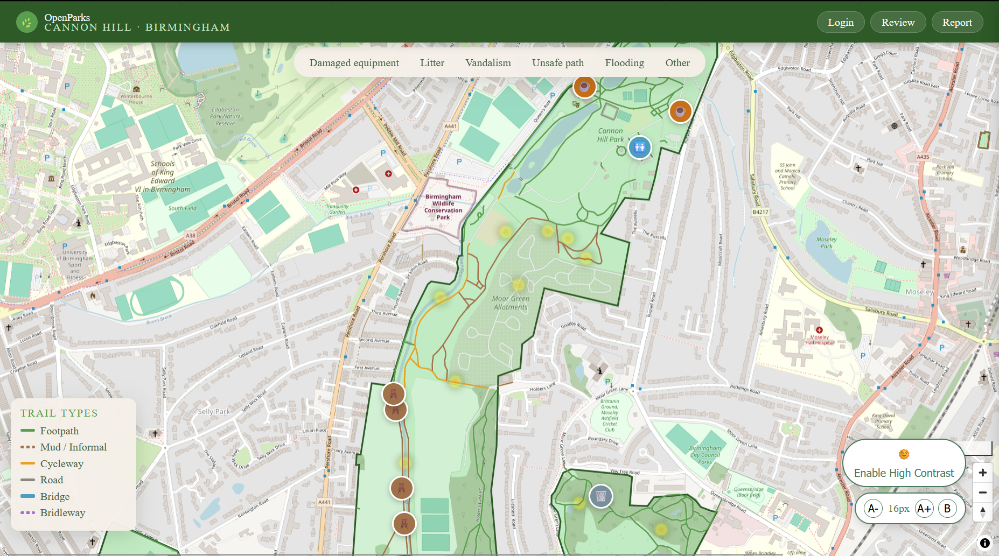
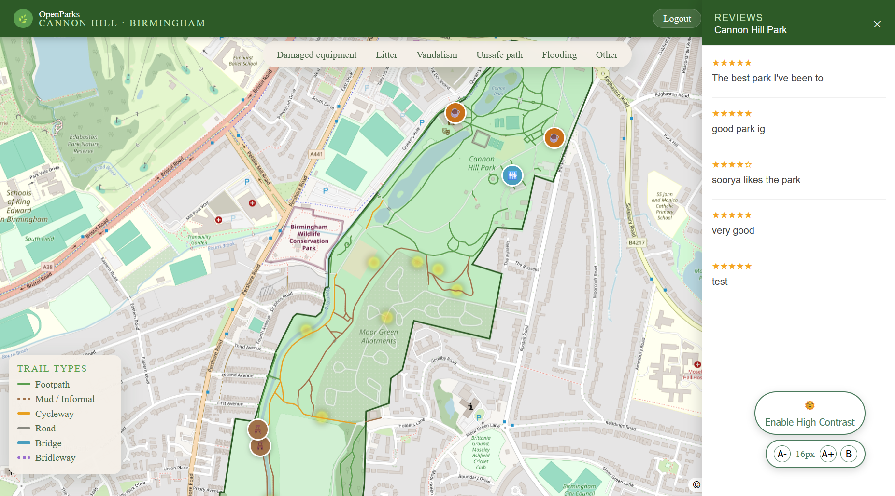
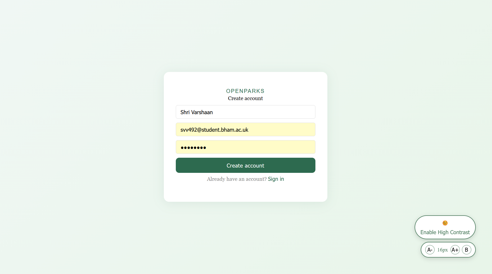
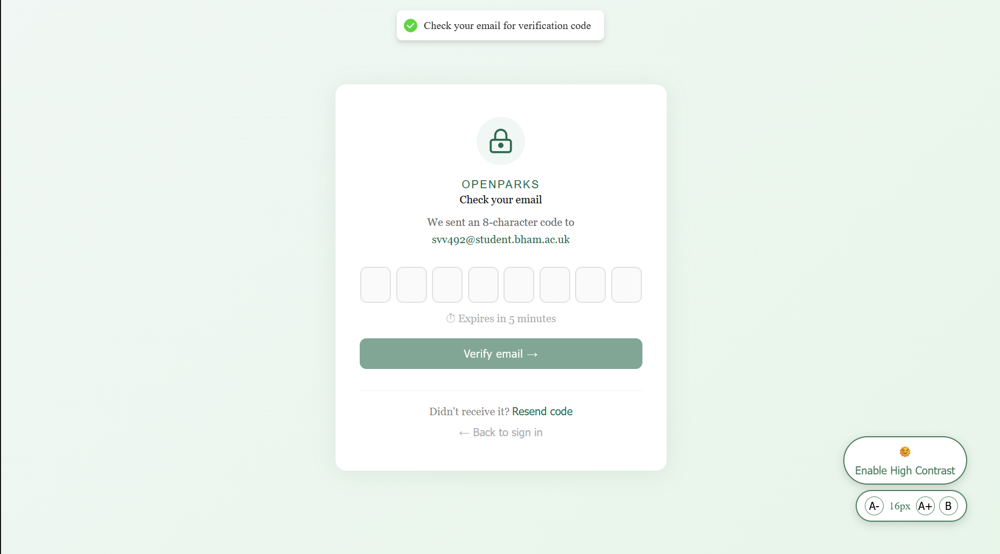
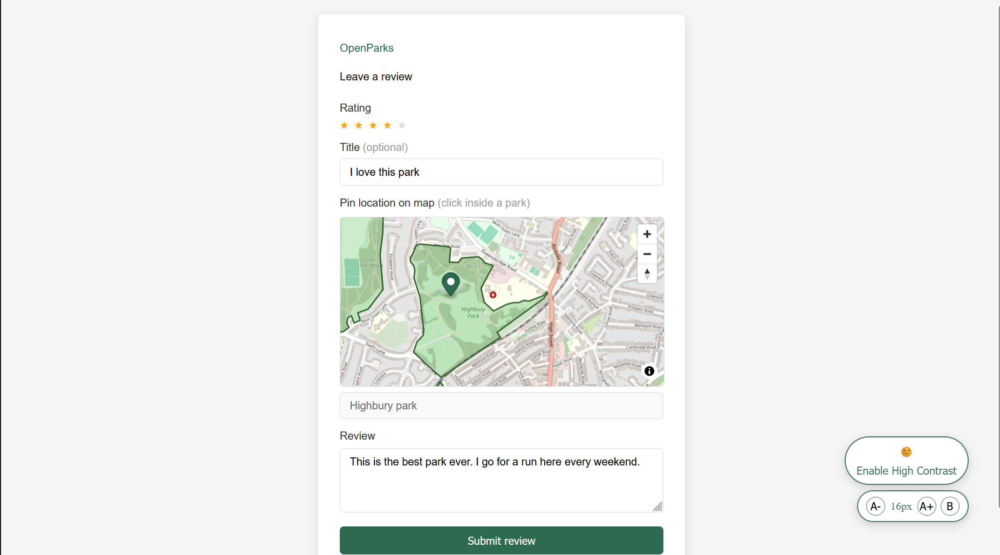
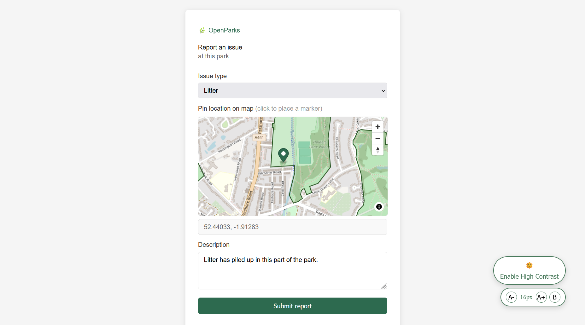
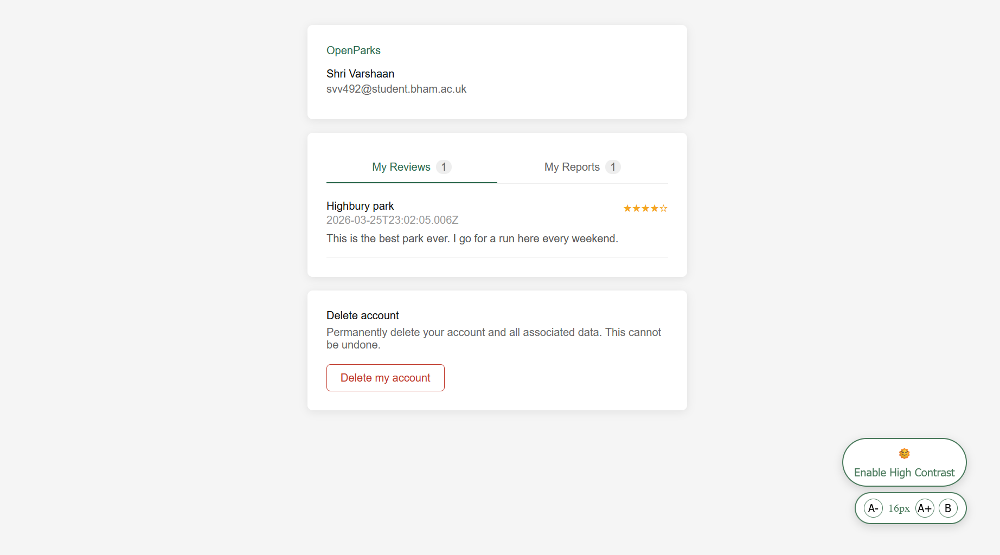

# OpenParks

A full-stack web application, built using the PERN stack (PostgreSQL + PostGIS, Express, React and Node.js) for discovering parks in Birmingham, submitting safety reports, leaving reviews, and browsing trails and amenities.

---

## Quick start

You need [Docker Desktop](https://www.docker.com/products/docker-desktop/) (running) and [Node.js](https://nodejs.org/) 22.12 or newer (20.19+ also works).

```bash
git clone https://github.com/ShriVarshaan/OpenParks.git
cd OpenParks

# 1. Start the database (PostGIS) and the email catcher (Mailpit)
docker compose up -d --wait

# 2. Install everything, create backend/.env, build the database and load the parks
npm run setup

# 3. Start the app — in two separate terminals
npm run dev:backend      # API on http://localhost:3000
npm run dev:frontend     # website on http://localhost:5173
```

Open **http://localhost:5173**.

- **Demo login:** `demo@openparks.local` / `openparks-demo` (already verified, with a few reviews).
- **Verification emails:** sign-up codes are caught by Mailpit. Read them at **http://localhost:8025**.
- `npm run setup` copies `backend/.env.example` to `backend/.env` the first time. The defaults work as-is; edit `.env` only to change ports, secrets or the mail server.

### Stopping and starting again

- `docker compose stop` pauses the database; `docker compose up -d --wait` brings it back with your data.
- To start from a clean database: `docker compose down -v`, then `docker compose up -d --wait` and `npm --prefix backend run setup`.

### Troubleshooting

| Problem | Fix |
|---|---|
| `docker compose up` says a port is in use | Another program is using 5433, 1025 or 8025. Create a file named `.env` in the repo root containing e.g. `OPENPARKS_DB_PORT=5434` (also `OPENPARKS_SMTP_PORT`, `OPENPARKS_MAIL_UI_PORT` if needed) and run `docker compose up -d --wait` again; Compose reads that file every time. Then run `node backend/scripts/ensure-env.js` to create `backend/.env`, change the port in its `DATABASE_URL` (and `EMAIL_PORT`) to match, and continue with `npm run setup`. For `npm run test:db`, also set `TEST_DATABASE_URL` to the same URL with database `openparks_test`. |
| The login page says "Cannot reach the server" | The backend isn't running. Start it with `npm run dev:backend`. |
| `npm run setup` fails with `P1001: Can't reach database server` | Docker isn't running, or the database is still starting. Run `docker compose up -d --wait` and try again. |
| The backend runs somewhere other than `localhost:3000` | Copy `frontend/.env.example` to `frontend/.env` and set `VITE_API_URL`. |

---

## Using the website

### Main page

On the main page of the site, is a map of the parks along with trail and amenity information. Clicking on any of the parks open a side pane with all the reviews associated with the park. Clicking on the toolbar on top shows all the report/hazard markers associated with the parks.

Zooming into a park will display all the amenities associated with it and zooming out will remove those details from the park. The parks also have a heatmap of the reports created in them.





### Login page

Login/signup to the app



> Running locally, the verification email never leaves your machine: open the Mailpit inbox at http://localhost:8025 to read the code.



### Reviews page

> Note: you'll have to login to access this page

In the reviews page, simply click on any park you want to leave a review for and leave your rating.



### Reports page

> Note: you'll have to login to access this page

In the reports page, simple click on the location in the map, to report a hazard.



### Account page

> Note: you'll have to login to access this page

In the accounts page you'll have access to all the reports you've filed and the reviews you've left. Additionally, you'll have the option to delete your openparks account and all associated data



---

## Frontend pages

| Page | Path | Description |
|---|---|---|
| Home | `/` | Map of parks, trails, amenities and the report heatmap |
| Report | `/report` | Submit a safety report for a park |
| Login | `/login` | Log in, sign up and verify your email |
| Review | `/review` | Leave a review for a park |
| Account | `/account` | Your reviews and reports; delete your account |

## API endpoints

| Resource | Base Path | Description |
|---|---|---|
| Parks | `/api/parks` | All parks as a GeoJSON FeatureCollection |
| Auth | `/api/auth` | Login, sign-up and email verification codes |
| Amenities | `/api/amenities` | Park amenities (benches, toilets, cafés, …) |
| Safety Reports | `/api/safetyreport` | Submit and retrieve safety reports |
| Reviews | `/api/reviews` | Post and fetch park reviews |
| Trails | `/api/trails` | Footpaths, cycleways and other trails in parks |
| User / Account | `/api/user` | Account details and deletion |

---

## Tech stack

| Layer | Technology |
|---|---|
| Frontend | React, Vite, MapLibre GL JS |
| Backend | Node.js, Express, Passport (JWT) |
| Database ORM | Prisma |
| Database | PostgreSQL with PostGIS (Docker for local development) |
| Email | Nodemailer (Mailpit locally) |
| Testing | Jest (backend), Vitest + Testing Library (frontend) |

---

## Park data

Parks, trails and amenities come from OpenStreetMap through the Overpass API. The data is saved as GeoJSON snapshots in `backend/prisma/data/`, so setting up never needs the internet beyond `npm install`. `npm run setup` loads the snapshots into the database (re-running `npm --prefix backend run db:seed` is safe).

Park, trail and amenity data © OpenStreetMap contributors, available under the Open Database License (ODbL).

### Adding more parks

1. Add an area to `backend/scripts/parks.config.json`. Each area is a name and a bounding box `[south, west, north, east]`. To leave out a park, add its OSM id (for example `"way/123"`) to `exclude`.
2. Download the new snapshots: `npm --prefix backend run parks:fetch`.
3. Load them: `npm --prefix backend run db:seed`.
4. Commit the changed files in `backend/prisma/data/`.

See `backend/prisma/data/README.md` for details.

---

## Testing

```bash
npm test                                   # backend unit + integration, and frontend tests

cd backend
npm run test:unit
npm run test:integration
npm run test:db                            # real PostGIS tests; needs `docker compose up -d --wait`

cd ../frontend
npx vitest run
```

`npm run test:db` only ever uses the separate `openparks_test` database, never your development data. Test plans: `backend/tests/testplan.md` and `frontend/test-plan.md`.

---

## Configuration

The backend reads `backend/.env` (see `backend/.env.example`):

| Variable | Purpose | Local default |
|---|---|---|
| `DATABASE_URL` | PostgreSQL connection string | the Docker database on port 5433 |
| `DB_SSL` | `true` for hosted databases that require SSL | `false` |
| `JWT_SECRET` | Signs login tokens. Change it for any real deployment | `change-me-in-production` |
| `EMAIL_HOST`, `EMAIL_PORT` | SMTP server for verification emails | Mailpit, `localhost:1025` |
| `EMAIL_USER`, `EMAIL_PASS` | SMTP login (leave empty for Mailpit) | empty |
| `EMAIL_FROM` | Sender address | `OpenParks <no-reply@openparks.local>` |
| `CORS_ORIGINS` | Comma-separated allowed frontend origins | `http://localhost:5173,http://localhost:5174` |
| `PORT` | API port | `3000` |

The frontend reads `VITE_API_URL` from `frontend/.env` (default `http://localhost:3000`). In development the email-code screen links to the Mailpit inbox at `VITE_MAIL_UI_URL` (default `http://localhost:8025`); production builds never show it.
